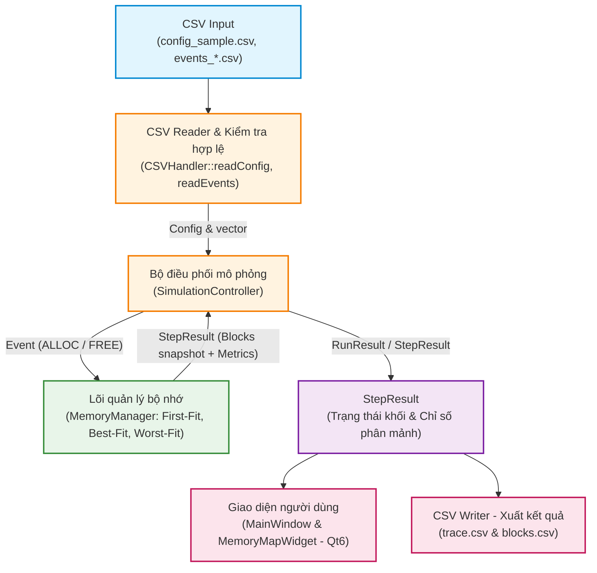

#TÀI LIỆU SƠ ĐỒ LƯU TRÌNH HỆ THỐNG (FLOWCHART)
## Dự án: Mô phỏng cấp phát bộ nhớ liên tục – Nhóm 03 (OS_MEM_11)
> **Mô tả:** Sơ đồ thể hiện luồng liên kết và truyền dữ liệu xuyên suốt giữa các tầng kiến trúc của chương trình theo đúng Mục 10 tài liệu đặc tả `report/spec.md`: Tầng Dữ liệu (CSV) $\rightarrow$ Tầng Điều phối (Simulation Controller) $\rightarrow$ Lõi thuật toán (Memory Manager Core) $\rightarrow$ Trạng thái kết quả (StepResult) $\rightarrow$ Giao diện hiển thị (Qt6 GUI) & Xuất tệp kết quả (`output/`).
---
### Sơ đồ luồng hoạt động tổng thể hệ thống (Architecture & Pipeline Flowchart)

---
### Nguyên tắc phân tầng cốt lõi (Separation of Concerns):
1. **Tầng Dữ liệu (Input / Output):** Xử lý định dạng CSV, kiểm tra tính hợp lệ dữ liệu và ghi kết quả vết thực thi (`trace.csv`, `blocks.csv`).
2. **Tầng Điều phối (Simulation Controller):** Quản lý chu trình chạy (Từng bước / Chạy tự động / Tạm dừng / Đặt lại), điều phối danh sách sự kiện đến các instance thuật toán.
3. **Lõi thuật toán (Memory Manager Core):** Độc lập hoàn toàn với giao diện đồ họa. Nhận sự kiện `ALLOC` / `FREE`, thực thi 3 chiến lược (**First-Fit**, **Best-Fit**, **Worst-Fit**), tự động tách khối, gộp khối (`coalescing`) và tính toán các chỉ số phân mảnh (`MemoryMetrics`).
4. **Tầng Hiển thị (Qt6 GUI):** Chỉ nhận `StepResult` snapshot để render sơ đồ thanh bộ nhớ động (`MemoryMapWidget`) và hiển thị bảng biểu, không tự can thiệp hay tính toán logic cấp phát.

# BẢNG PHÂN CÔNG TRÁCH NHIỆM & ĐÓNG GÓP THÀNH VIÊN
## Dự án: Mô phỏng cấp phát bộ nhớ liên tục – Nhóm 03 (OS_MEM_11)
---
### 6.1. Phương pháp tổ chức và quản lý nhóm
Nhóm 03 áp dụng quy trình phát triển phần mềm chuẩn mực hướng kiến trúc module hóa:
* **Quản lý phiên bản (Version Control):** Sử dụng Git & GitHub repository. Mọi tính năng phát triển trên branch riêng và chỉ merge vào nhánh main khi đã vượt qua CI/CD test.
* **Tự động hóa CI/CD:** Pipeline GitHub Actions tự động build bằng MinGW/CMake và chạy toàn bộ kiểm thử hồi quy (`ctest`) mỗi khi tạo Pull Request hoặc Push code.
* **Cơ chế hợp đồng giao tiếp (Contract-First Design):** Toàn bộ nhóm thống nhất tệp `models.h` và tài liệu đặc tả `spec.md` trước khi triển khai code độc lập, giúp ngăn chặn xung đột kết nối giữa tầng Core, tầng CSV và tầng Giao diện đồ họa (GUI).
---
### 6.2. Bảng phân công công việc và đóng góp thành viên
| Họ và tên | MSSV | Output chịu trách nhiệm | Tỉ lệ đóng góp | Đánh giá |
|:---|:---|:---|:---:|:---:|
| **[Họ và tên Người 1]** *(Trưởng nhóm)* | [MSSV 1] | Mô hình, giả định, flowchart tổng thể; báo cáo hoàn chỉnh; điều phối và bảng phân công | **25%** | Hoàn thành tốt |
| **[Họ và tên Người 2]** | [MSSV 2] | Module Core (`memory_manager.h/.cpp`): First-Fit, Best-Fit, Worst-Fit; logic gộp/tách khối, làm tròn đơn vị, metrics | **25%** | Hoàn thành tốt |
| **[Họ và tên Người 3]** | [MSSV 3] | Module CSV Reader/Writer (`csv_handler.h/.cpp`); xây dựng bộ dữ liệu kiểm thử (`config_sample.csv`, `events_*.csv`); thiết kế unit tests | **25%** | Hoàn thành tốt |
| **[Họ và tên Người 4]** | [MSSV 4] | Thiết kế giao diện Qt6 Widgets (`main_window`, `memory_map_widget`); cài đặt bộ điều phối (`simulation_controller`); cấu hình CI/CD Windows | **25%** | Hoàn thành tốt |
---
