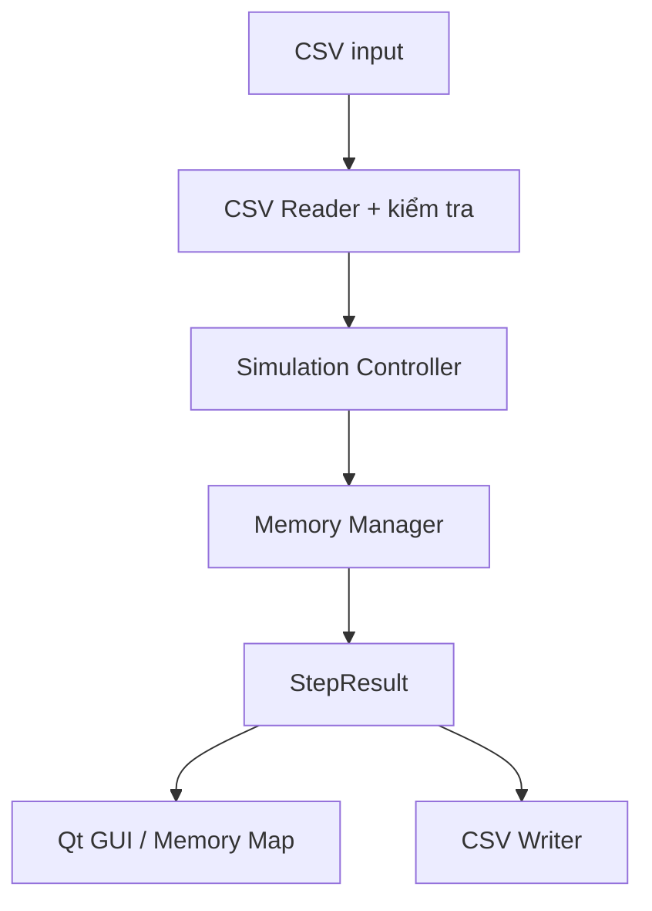
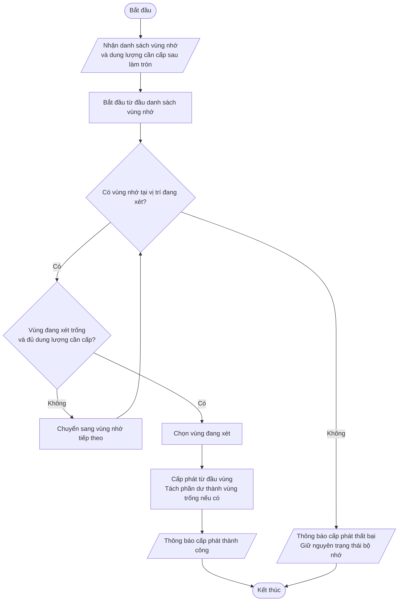
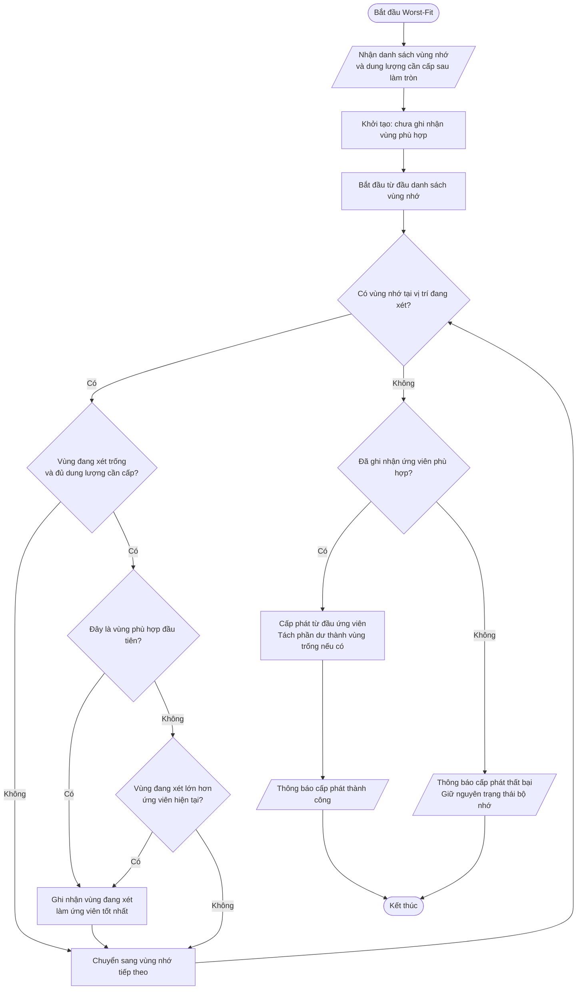

# Đặc tả mô phỏng cấp phát bộ nhớ liên tục

## 1. Phạm vi mô phỏng

Chương trình mô phỏng **cấp phát bộ nhớ liên tục động** (dynamic contiguous memory allocation) bằng ba chiến lược:

- First-Fit
- Best-Fit
- Worst-Fit

Chương trình nhận lần lượt hai loại thao tác:

- `ALLOC`: cấp một vùng nhớ cho tiến trình.
- `FREE`: thu hồi vùng nhớ của tiến trình.

Sau mỗi thao tác, chương trình lưu trạng thái các vùng nhớ để giao diện hiển thị Memory Map và để xuất trace ra CSV.

Đây là chương trình **mô phỏng**, không can thiệp vào RAM thật của Windows. Phạm vi hiện tại không gồm compaction, paging, segmentation, chạy đa luồng hoặc tự động thu hồi theo thời gian sống. Bộ nhớ chỉ được thu hồi khi có lệnh `FREE`.

## 2. Đơn vị và trạng thái ban đầu

- Mọi dung lượng và địa chỉ đều dùng đơn vị **KB**.
- Địa chỉ bắt đầu từ `0`.
- Nếu tổng bộ nhớ là `1024 KB`, miền địa chỉ hợp lệ là từ `0` đến `1023`.
- Khi bắt đầu hoặc Reset, toàn bộ bộ nhớ là một vùng trống: `start = 0`, `size = total_memory_kb`.
- Đơn vị cấp phát mặc định là `4 KB`.

Dung lượng thật sự cần cấp được làm tròn lên theo đơn vị cấp phát:

```text
allocated_size = ceil(requested_size / allocation_unit) * allocation_unit
internal_fragmentation = allocated_size - requested_size
```

Ví dụ: tiến trình yêu cầu `5 KB`, đơn vị cấp phát `4 KB`; chương trình cấp `8 KB` và phân mảnh trong là `3 KB`.

## 3. Quy tắc chọn vùng nhớ

| Chiến lược | Cách chọn |
|---|---|
| First-Fit | Duyệt từ địa chỉ thấp đến cao, chọn vùng trống đầu tiên đủ lớn. |
| Best-Fit | Chọn vùng trống đủ lớn có kích thước nhỏ nhất. |
| Worst-Fit | Chọn vùng trống đủ lớn có kích thước lớn nhất. |

Nếu nhiều vùng cùng phù hợp theo Best-Fit hoặc Worst-Fit, chọn vùng có **địa chỉ bắt đầu nhỏ nhất**. Quy tắc này giúp cùng một input luôn tạo cùng một kết quả.

## 4. Tách và gộp vùng

### Khi cấp phát

1. Tìm vùng trống theo chiến lược đã chọn.
2. Cấp phát từ đầu vùng trống.
3. Nếu kích thước vùng trống bằng đúng kích thước cần cấp, đổi cả vùng thành đã dùng.
4. Nếu vùng trống lớn hơn, tách thành một vùng đã dùng và một vùng trống còn lại.
5. Nếu không có vùng phù hợp, ghi thất bại và giữ nguyên trạng thái bộ nhớ.

### Khi thu hồi

1. Tìm vùng đang thuộc tiến trình cần thu hồi.
2. Đổi vùng đó thành vùng trống.
3. Nếu vùng trống bên trái liền kề, gộp lại.
4. Nếu vùng trống bên phải liền kề, tiếp tục gộp.
5. Nếu không tìm thấy tiến trình, ghi thất bại và giữ nguyên trạng thái.

## 5. Thông tin của một vùng nhớ

```cpp
struct MemoryBlock {
    int startAddressKb;
    int allocatedSizeKb;
    int requestedSizeKb; // bằng 0 nếu vùng trống
    std::string processId; // rỗng nếu vùng trống
    bool isFree;
};
```

Ý nghĩa:

- `startAddressKb`: địa chỉ đầu của vùng.
- `allocatedSizeKb`: dung lượng vùng thật sự chiếm.
- `requestedSizeKb`: dung lượng tiến trình yêu cầu trước khi làm tròn.
- `processId`: mã tiến trình, ví dụ `P1`.
- `isFree`: `true` nếu vùng trống, `false` nếu đã cấp.

## 6. Điều kiện luôn phải đúng

Sau mỗi thao tác, chương trình phải kiểm tra:

1. Các vùng được sắp theo địa chỉ tăng dần.
2. Hai vùng không chồng lên nhau.
3. Không có khoảng trống bị bỏ sót giữa hai vùng.
4. Tổng kích thước các vùng luôn bằng tổng bộ nhớ.
5. Kích thước mỗi vùng lớn hơn 0.
6. Sau khi gộp, không còn hai vùng trống nằm cạnh nhau.
7. Một mã tiến trình chỉ được giữ tối đa một vùng nhớ.
8. Địa chỉ đầu tiên là 0 và điểm kết thúc cuối cùng bằng tổng bộ nhớ.

## 7. File `input/config_sample.csv`

```csv
total_memory_kb,allocation_unit_kb,strategy
1024,4,ALL
```

| Cột | Ý nghĩa | Quy tắc |
|---|---|---|
| `total_memory_kb` | Tổng bộ nhớ | Số nguyên lớn hơn 0. |
| `allocation_unit_kb` | Đơn vị làm tròn | Số nguyên lớn hơn 0 và không lớn hơn tổng bộ nhớ. |
| `strategy` | Chiến lược chạy | `FIRST_FIT`, `BEST_FIT`, `WORST_FIT` hoặc `ALL`. |

`ALL` nghĩa là chạy cùng một danh sách thao tác độc lập với cả ba chiến lược để so sánh.
Giá trị `strategy` trong file config quyết định số lượt mô phỏng. Trong GUI, khi config là `ALL`, hộp chọn chiến lược chỉ thay đổi cách hiển thị một hoặc ba lượt chạy; thao tác Export vẫn ghi kết quả của cả ba. Với config chọn một chiến lược cụ thể, hộp chọn không thay đổi chiến lược đã nạp.

## 8. File sự kiện (ví dụ `input/events_normal.csv`)

```csv
step,operation,pid,size_kb
1,ALLOC,P1,100
2,ALLOC,P2,250
3,FREE,P1,
4,ALLOC,P3,80
```

| Cột | Ý nghĩa | Quy tắc |
|---|---|---|
| `step` | Thứ tự thao tác | Số nguyên dương, không trùng, file phải theo thứ tự tăng dần. |
| `operation` | Loại thao tác | Chỉ nhận `ALLOC` hoặc `FREE`. |
| `pid` | Mã tiến trình | Không rỗng; chỉ gồm chữ, số, `_` hoặc `-`; không chứa dấu phẩy. |
| `size_kb` | Dung lượng yêu cầu | Với `ALLOC`: số nguyên lớn hơn 0. Với `FREE`: để trống. |

Quy tắc khi chạy:

- `ALLOC` một PID đang giữ bộ nhớ: thất bại, bộ nhớ không đổi.
- `FREE` một PID chưa được cấp: thất bại, bộ nhớ không đổi.
- File rỗng, thiếu cột, sai kiểu dữ liệu hoặc sai tên thao tác: từ chối chạy và báo dòng gây lỗi.
- Một dòng lỗi không được làm chương trình bị crash.

File `input/events_invalid.csv` là ví dụ dữ liệu sai để kiểm tra xử lý lỗi.

Parser chấp nhận UTF-8 có BOM và bỏ qua dòng trắng. Config cần đúng một dòng dữ liệu; file events có header hợp lệ nhưng không có sự kiện vẫn đọc thành công. Trường dữ liệu nằm trên một dòng, có thể được đặt trong dấu nháy kép theo quy tắc CSV. Khi một dòng sai, hàm đọc trả lỗi kèm đường dẫn và vị trí áp dụng được, không trả danh sách sự kiện đã nạp một phần; GUI giữ phiên hợp lệ trước đó. Controller cũng kiểm tra các giá trị đầu vào trước khi tạo lượt chạy, gồm trường hợp kích thước cấp phát sau làm tròn vượt giới hạn `int`.

## 9. Dữ liệu đầu ra

Chương trình xuất hai loại CSV. File mẫu trong `output/` được tạo từ `input/config_sample.csv` và `input/events_compare.csv` gồm 12 sự kiện chạy theo cả ba chiến lược.

### `output/trace.csv`

Mỗi thao tác là một dòng:

```text
strategy,step,operation,pid,requested_size_kb,allocated_size_kb,success,message,total_free_kb,largest_free_block_kb,hole_count,internal_fragmentation_kb,external_fragmentation_kb,external_fragmentation_ratio
```

Trong đó:

- `success`: `true` hoặc `false`.
- `total_free_kb`: tổng dung lượng các vùng trống.
- `largest_free_block_kb`: vùng trống lớn nhất.
- `hole_count`: số vùng trống.
- `internal_fragmentation_kb`: tổng phần làm tròn dư của các vùng đã cấp.
- `external_fragmentation_kb = total_free_kb - largest_free_block_kb`.
- `external_fragmentation_ratio`: bằng 0 nếu không còn bộ nhớ trống; ngược lại bằng `external_fragmentation_kb / total_free_kb`.

Mỗi sự kiện đã xử lý, kể cả thất bại, tạo một dòng trace cho mỗi chiến lược đang chạy. `FREE` và `ALLOC` thất bại có `allocated_size_kb = 0`; thất bại không thay đổi trạng thái bộ nhớ. Tỷ lệ phân mảnh được xuất với bốn chữ số thập phân. Trạng thái ban đầu là snapshot bước 0, không phải một dòng sự kiện trong trace.

### `output/blocks.csv`

Mỗi vùng nhớ tại mỗi bước là một dòng:

```text
strategy,step,block_index,start_address_kb,size_kb,is_free,pid,requested_size_kb,internal_fragmentation_kb
```

Hai file đầu ra phải đủ thông tin để tái tạo Memory Map tại bất kỳ bước nào.
Các dòng block được nhóm theo cặp `(strategy, step)` và sắp theo `block_index`; địa chỉ kết thúc của mỗi block là `start_address_kb + size_kb` và không nằm trong block. Khi Export giữa chừng, hai file chỉ chứa các sự kiện đã xử lý đến thời điểm đó.

## 10. Cách nối các phần chương trình



`SimulationController::loadScenario` nạp toàn bộ cấu hình và sự kiện; `stepForward` là thao tác xử lý một event được cả nút Next và bộ hẹn giờ Run sử dụng. `reset` dựng lại các state ban đầu. GUI đọc `runs` để vẽ Memory Map, bảng block, trace và metrics theo cùng chỉ số sự kiện; API `snapshotAfter` cho phép truy vấn một snapshot đã xử lý. GUI không tự tính lại chỉ số bộ nhớ hay chọn hole.

### Kiểm thử và đo hiệu năng

CTest có ba mục `memory_manager`, `memory_stress` và `csv_handler`. Kiểm thử CSV đọc workload `events_compare.csv`, chạy `SimulationController`, xuất trace của từng chiến lược rồi so từng dòng với ba file trong `tests/expected/`. File expected thiếu hoặc dòng sai làm test thất bại. Stress test sử dụng ba workload và các cỡ 100, 1.000, 10.000 sự kiện.

Benchmark Core chạy riêng ở bản Release. Phương pháp đo, bảng median và dữ liệu thô của một lần chạy được lưu tại [benchmark-results.md](benchmark-results.md) và [memory-benchmark.csv](memory-benchmark.csv). Thời gian benchmark không bao gồm thao tác GUI hay ghi CSV.

## 11. Xử lý lỗi

| Trường hợp | Cách xử lý |
|---|---|
| Không mở được file | Hiện thông báo có tên file; không chạy mô phỏng. |
| Thiếu hoặc sai tên cột | Báo tên cột cần có; không chạy. |
| Dữ liệu không phải số | Báo số dòng và tên cột; không crash. |
| Tổng bộ nhớ/đơn vị cấp phát không hợp lệ | Từ chối cấu hình. |
| Không đủ một vùng trống liên tục | Ghi cấp phát thất bại; trạng thái không đổi. |
| PID bị cấp hai lần | Ghi thất bại; trạng thái không đổi. |
| Thu hồi PID không tồn tại | Ghi thất bại; trạng thái không đổi. |
| Không ghi được output | Hiện lỗi đường dẫn/quyền ghi; kết quả trên màn hình vẫn được giữ. |

## 12. Lưu đồ thuật toán chọn vùng nhớ

### 12.1. First-Fit

Chọn vùng trống đầu tiên đủ dung lượng khi duyệt theo địa chỉ tăng dần.



### 12.2. Best-Fit

Duyệt theo địa chỉ tăng dần, chọn vùng trống đủ dung lượng có kích thước nhỏ nhất.


### 12.3. Worst-Fit

Duyệt theo địa chỉ tăng dần, chọn vùng trống đủ dung lượng có kích thước lớn nhất.



Nếu hai vùng trống có cùng kích thước, Best-Fit và Worst-Fit giữ ứng viên được ghi nhận trước, tức vùng có địa chỉ thấp nhất.

Trong ba lưu đồ, "Bắt đầu từ đầu danh sách vùng nhớ" chỉ xác định vị trí đầu tiên để kiểm tra. Nếu tại vị trí đang xét có vùng nhớ, thuật toán kiểm tra vùng đó; nếu không, danh sách đã được duyệt hết. Với Best-Fit và Worst-Fit, vùng phù hợp đầu tiên được ghi nhận làm ứng viên; các vùng phù hợp tiếp theo được so với ứng viên để giữ vùng nhỏ nhất hoặc lớn nhất. Sau khi duyệt hết, nếu còn ứng viên thì cấp phát từ vùng đó, nếu không thì báo thất bại.

# 13. BẢNG PHÂN THÀNH VIÊN

### Bảng phân thành viên
 STT | Họ và tên | MSSV | Vai trò / Vị trí | Nhiệm vụ / Output chịu trách nhiệm | Đánh giá |
|:---:|:---|:---:|:---|:---|:---:|
| 1 | **Lưu Nguyễn Anh Dũng** | `0978175535` | Trưởng nhóm kiêm Quản lý Tích hợp & Tài liệu | Quản lý tích hợp hệ thống, tài liệu tổng thể, mô hình toán học & giả định, flowchart kiến trúc, điều phối và tổng hợp báo cáo | **100%** |
| 2 | **La Minh Nhựt** | `083205001906` | Kỹ sư Lõi thuật toán<br>*(Core Logic Engineer)* | Module Core (`memory_manager.h/.cpp`): Cài đặt thuật toán First-Fit, Best-Fit, Worst-Fit; logic tách/gộp khối (`coalesce`), làm tròn đơn vị cấp phát, kiểm tra bất biến `validateState` | **100%** |
| 3 | **Đào Thị Uyên Vy** | `[Điền MSSV]` | Kỹ sư Kiểm thử, Test Oracle & Hiệu năng | Xây dựng bộ test cases hồi quy (`test_memory_manager.cpp`), kiểm thử bất biến trạng thái, kiểm thử áp lực (stress test) và đo lường benchmark hiệu năng | **100%** |
| 4 | **Nguyễn Gia Hưng** | `068205012392` | Lập trình viên Giao diện GUI<br>*(GUI Developer)* | Thiết kế giao diện Qt6 Widgets (`main_window.ui/.cpp`), vẽ sơ đồ thanh bộ nhớ động (`memory_map_widget.cpp`), bộ điều phối mô phỏng (`simulation_controller.cpp`), cấu hình CI/CD GitHub Actions | **100%** |
| 5 | **Huỳnh Long Phi** | `079207026464` | Kỹ sư Xử lý dữ liệu CSV & Tài liệu kỹ thuật | Module CSV Reader/Writer (`csv_handler.h/.cpp`); xây dựng bộ dữ liệu kiểm thử input/output (`config_sample.csv`, `events_*.csv`); soạn thảo phụ lục kỹ thuật và đặc tả dữ liệu | **100%** |
---
