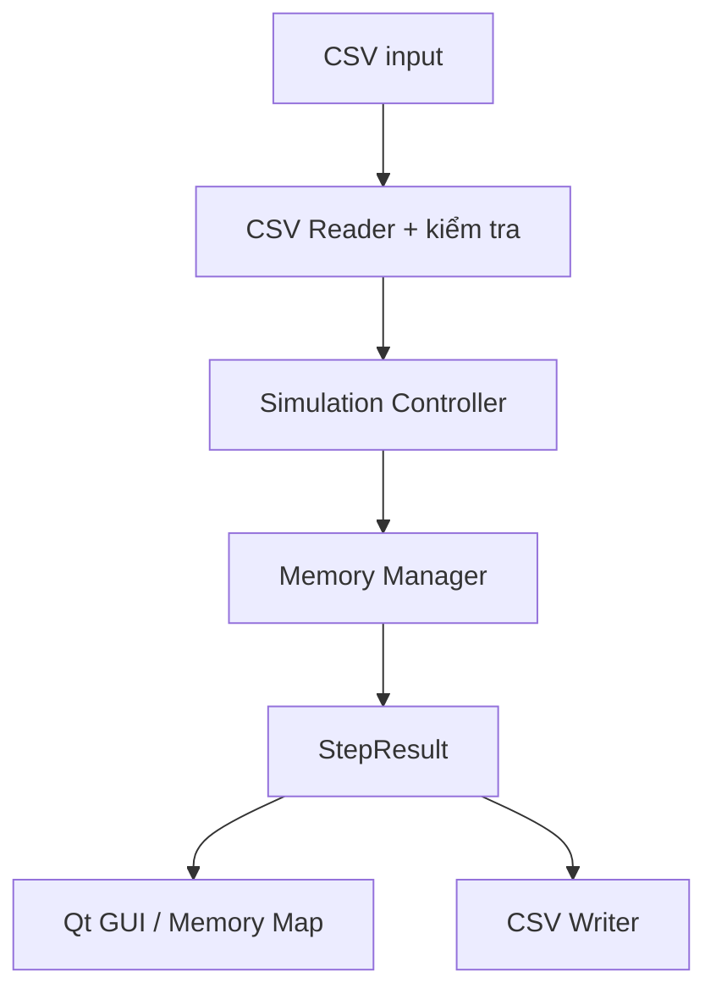

# Đặc tả mô phỏng cấp phát bộ nhớ liên tục

Tài liệu này chốt cách mô phỏng, dữ liệu CSV và cách các phần của chương trình trao đổi dữ liệu. Đây là cơ sở để TV2 làm thuật toán, TV5 làm CSV và TV4 làm giao diện mà không phải tự đoán.

## 1. Phạm vi mô phỏng

Chương trình mô phỏng **cấp phát bộ nhớ liên tục động** (dynamic contiguous memory allocation) bằng ba chiến lược:

- First-Fit
- Best-Fit
- Worst-Fit

Chương trình nhận lần lượt hai loại thao tác:

- `ALLOC`: cấp một vùng nhớ cho tiến trình.
- `FREE`: thu hồi vùng nhớ của tiến trình.

Sau mỗi thao tác, chương trình lưu trạng thái các vùng nhớ để giao diện hiển thị Memory Map và để xuất trace ra CSV.

Đây là chương trình **mô phỏng**, không can thiệp vào RAM thật của Windows. Phạm vi hiện tại không gồm compaction, paging, segmentation, chạy đa luồng hoặc tự động thu hồi theo thời gian sống. Bộ nhớ chỉ được thu hồi khi có lệnh `FREE`.

## 2. Đơn vị và trạng thái ban đầu

- Mọi dung lượng và địa chỉ đều dùng đơn vị **KB**.
- Địa chỉ bắt đầu từ `0`.
- Nếu tổng bộ nhớ là `1024 KB`, miền địa chỉ hợp lệ là từ `0` đến `1023`.
- Khi bắt đầu hoặc Reset, toàn bộ bộ nhớ là một vùng trống: `start = 0`, `size = total_memory_kb`.
- Đơn vị cấp phát mặc định là `4 KB`.

Dung lượng thật sự cần cấp được làm tròn lên theo đơn vị cấp phát:

```text
allocated_size = ceil(requested_size / allocation_unit) * allocation_unit
internal_fragmentation = allocated_size - requested_size
```

Ví dụ: tiến trình yêu cầu `5 KB`, đơn vị cấp phát `4 KB`; chương trình cấp `8 KB` và phân mảnh trong là `3 KB`.

## 3. Quy tắc chọn vùng nhớ

| Chiến lược | Cách chọn |
|---|---|
| First-Fit | Duyệt từ địa chỉ thấp đến cao, chọn vùng trống đầu tiên đủ lớn. |
| Best-Fit | Chọn vùng trống đủ lớn có kích thước nhỏ nhất. |
| Worst-Fit | Chọn vùng trống đủ lớn có kích thước lớn nhất. |

Nếu nhiều vùng cùng phù hợp theo Best-Fit hoặc Worst-Fit, chọn vùng có **địa chỉ bắt đầu nhỏ nhất**. Quy tắc này giúp cùng một input luôn tạo cùng một kết quả.

## 4. Tách và gộp vùng

### Khi cấp phát

1. Tìm vùng trống theo chiến lược đã chọn.
2. Cấp phát từ đầu vùng trống.
3. Nếu kích thước vùng trống bằng đúng kích thước cần cấp, đổi cả vùng thành đã dùng.
4. Nếu vùng trống lớn hơn, tách thành một vùng đã dùng và một vùng trống còn lại.
5. Nếu không có vùng phù hợp, ghi thất bại và giữ nguyên trạng thái bộ nhớ.

### Khi thu hồi

1. Tìm vùng đang thuộc tiến trình cần thu hồi.
2. Đổi vùng đó thành vùng trống.
3. Nếu vùng trống bên trái liền kề, gộp lại.
4. Nếu vùng trống bên phải liền kề, tiếp tục gộp.
5. Nếu không tìm thấy tiến trình, ghi thất bại và giữ nguyên trạng thái.

## 5. Thông tin của một vùng nhớ

```cpp
struct MemoryBlock {
    int startAddressKb;
    int allocatedSizeKb;
    int requestedSizeKb; // bằng 0 nếu vùng trống
    std::string processId; // rỗng nếu vùng trống
    bool isFree;
};
```

Ý nghĩa:

- `startAddressKb`: địa chỉ đầu của vùng.
- `allocatedSizeKb`: dung lượng vùng thật sự chiếm.
- `requestedSizeKb`: dung lượng tiến trình yêu cầu trước khi làm tròn.
- `processId`: mã tiến trình, ví dụ `P1`.
- `isFree`: `true` nếu vùng trống, `false` nếu đã cấp.

## 6. Điều kiện luôn phải đúng

Sau mỗi thao tác, chương trình phải kiểm tra:

1. Các vùng được sắp theo địa chỉ tăng dần.
2. Hai vùng không chồng lên nhau.
3. Không có khoảng trống bị bỏ sót giữa hai vùng.
4. Tổng kích thước các vùng luôn bằng tổng bộ nhớ.
5. Kích thước mỗi vùng lớn hơn 0.
6. Sau khi gộp, không còn hai vùng trống nằm cạnh nhau.
7. Một mã tiến trình chỉ được giữ tối đa một vùng nhớ.
8. Địa chỉ đầu tiên là 0 và điểm kết thúc cuối cùng bằng tổng bộ nhớ.

## 7. File `input/config_sample.csv`

```csv
total_memory_kb,allocation_unit_kb,strategy
1024,4,ALL
```

| Cột | Ý nghĩa | Quy tắc |
|---|---|---|
| `total_memory_kb` | Tổng bộ nhớ | Số nguyên lớn hơn 0. |
| `allocation_unit_kb` | Đơn vị làm tròn | Số nguyên lớn hơn 0 và không lớn hơn tổng bộ nhớ. |
| `strategy` | Chiến lược chạy | `FIRST_FIT`, `BEST_FIT`, `WORST_FIT` hoặc `ALL`. |

`ALL` nghĩa là chạy cùng một danh sách thao tác độc lập với cả ba chiến lược để so sánh.

## 8. File sự kiện (ví dụ `input/events_normal.csv`)

```csv
step,operation,pid,size_kb
1,ALLOC,P1,100
2,ALLOC,P2,250
3,FREE,P1,
4,ALLOC,P3,80
```

| Cột | Ý nghĩa | Quy tắc |
|---|---|---|
| `step` | Thứ tự thao tác | Số nguyên dương, không trùng, file phải theo thứ tự tăng dần. |
| `operation` | Loại thao tác | Chỉ nhận `ALLOC` hoặc `FREE`. |
| `pid` | Mã tiến trình | Không rỗng; chỉ gồm chữ, số, `_` hoặc `-`; không chứa dấu phẩy. |
| `size_kb` | Dung lượng yêu cầu | Với `ALLOC`: số nguyên lớn hơn 0. Với `FREE`: để trống. |

Quy tắc khi chạy:

- `ALLOC` một PID đang giữ bộ nhớ: thất bại, bộ nhớ không đổi.
- `FREE` một PID chưa được cấp: thất bại, bộ nhớ không đổi.
- File rỗng, thiếu cột, sai kiểu dữ liệu hoặc sai tên thao tác: từ chối chạy và báo dòng gây lỗi.
- Một dòng lỗi không được làm chương trình bị crash.

File `input/events_invalid.csv` là ví dụ dữ liệu sai để kiểm tra xử lý lỗi.

## 9. Dữ liệu đầu ra

Chương trình dự kiến xuất hai loại CSV.

### `output/trace.csv`

Mỗi thao tác là một dòng:

```text
strategy,step,operation,pid,requested_size_kb,allocated_size_kb,success,message,total_free_kb,largest_free_block_kb,hole_count,internal_fragmentation_kb,external_fragmentation_kb,external_fragmentation_ratio
```

Trong đó:

- `success`: `true` hoặc `false`.
- `total_free_kb`: tổng dung lượng các vùng trống.
- `largest_free_block_kb`: vùng trống lớn nhất.
- `hole_count`: số vùng trống.
- `internal_fragmentation_kb`: tổng phần làm tròn dư của các vùng đã cấp.
- `external_fragmentation_kb = total_free_kb - largest_free_block_kb`.
- `external_fragmentation_ratio`: bằng 0 nếu không còn bộ nhớ trống; ngược lại bằng `external_fragmentation_kb / total_free_kb`.

### `output/blocks.csv`

Mỗi vùng nhớ tại mỗi bước là một dòng:

```text
strategy,step,block_index,start_address_kb,size_kb,is_free,pid,requested_size_kb,internal_fragmentation_kb
```

Hai file đầu ra phải đủ thông tin để tái tạo Memory Map tại bất kỳ bước nào.

## 10. Cách nối các phần chương trình



Nguyên tắc quan trọng: GUI chỉ gửi thao tác và hiển thị `StepResult`. GUI không tự chọn vùng nhớ và không chứa thuật toán First-Fit, Best-Fit hoặc Worst-Fit.

Ví dụ rút gọn về dữ liệu trao đổi và API dự kiến (không phải code đã triển khai). Định nghĩa kiểu đầy đủ hiện hành nằm trong `source/models.h`, gồm cả `Strategy::All` dành cho config/controller. API Memory Manager và Simulation Controller chưa được khai báo; CSV Handler mới có hàm đọc/ghi bảng dữ liệu thô:

```cpp
enum class Strategy { FirstFit, BestFit, WorstFit };

struct StepResult {
    int step;
    bool success;
    std::string message;
    std::vector<MemoryBlock> blocks;
};

class MemoryManager {
public:
    MemoryManager(int totalMemoryKb, int allocationUnitKb);
    void reset();
    StepResult allocate(
        int step,
        const std::string& processId,
        int requestedSizeKb,
        Strategy strategy
    );
    StepResult deallocate(int step, const std::string& processId);
    std::vector<MemoryBlock> getBlocks() const;
};

Config readConfig(const std::string& path);
std::vector<Event> readEvents(const std::string& path);
void writeTrace(const std::string& path,
                const std::vector<StepResult>& results);
```

## 11. Xử lý lỗi

| Trường hợp | Cách xử lý |
|---|---|
| Không mở được file | Hiện thông báo có tên file; không chạy mô phỏng. |
| Thiếu hoặc sai tên cột | Báo tên cột cần có; không chạy. |
| Dữ liệu không phải số | Báo số dòng và tên cột; không crash. |
| Tổng bộ nhớ/đơn vị cấp phát không hợp lệ | Từ chối cấu hình. |
| Không đủ một vùng trống liên tục | Ghi cấp phát thất bại; trạng thái không đổi. |
| PID bị cấp hai lần | Ghi thất bại; trạng thái không đổi. |
| Thu hồi PID không tồn tại | Ghi thất bại; trạng thái không đổi. |
| Không ghi được output | Hiện lỗi đường dẫn/quyền ghi; kết quả trên màn hình vẫn được giữ. |

## 12. Phân công kiểm tra tài liệu

- TV1: viết và cập nhật đặc tả.
- TV2: kiểm tra quy tắc thuật toán, tách/gộp vùng và các điều kiện luôn đúng.
- TV3: kiểm tra dữ liệu `StepResult` có đủ để làm giao diện và Memory Map.
- TV5: kiểm tra định dạng CSV và lỗi nhập/xuất.
- Reviewer chính của QT01-02: TV4, ghi **Đạt/Cần sửa** và ngày kiểm tra vào bảng tiến độ.

Chỉ thay đổi quy tắc trong tài liệu này sau khi nhóm thống nhất, vì thay đổi có thể ảnh hưởng đồng thời đến thuật toán, CSV, GUI và test.
